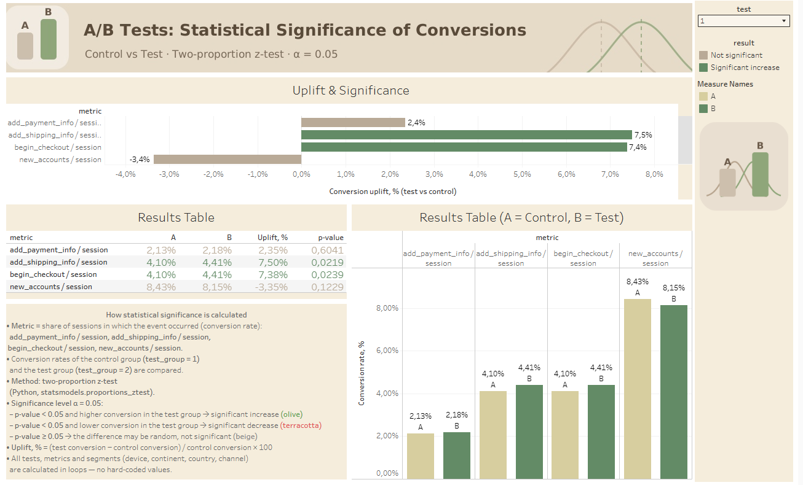

# A/B Test Statistical Significance

Statistical analysis of four A/B tests of an e-commerce website: a Python script checks whether changes in key conversion metrics are statistically significant, and a Tableau dashboard shows where the metrics really changed and where they did not.



## Links

- 📊 **Tableau dashboard:** [A/B Test Dashboard (Overview + Significance)](https://public.tableau.com/views/ABTestDashboard_17925770139850/Significance)
- 📓 **Google Colab notebook:** [ab_test_significance.ipynb](https://colab.research.google.com/github/ButenkoYuliia/ab-test-significance/blob/main/ab_test_significance.ipynb)
- 📓 **Original Colab notebook with outputs (Ukrainian):** [open in Colab](https://colab.research.google.com/drive/1e-JEP-QysmhbRnLBGNRQ9DETorSClouz?usp=sharing)
- 📁 **Results CSV:** [data/ab_test_results.csv](data/ab_test_results.csv)

## Business question

Which of the four A/B tests produced a real (statistically significant) change in the checkout funnel and sign-ups, and which differences are just random noise?

## Data

- Source: Google BigQuery, e-commerce dataset "DA" (GA4-style events), Nov 2020 – Jan 2021
- Aggregated by date, test, test group, device, continent, country and channel
- Value = number of **unique sessions** with each event

## Metrics

| Metric | Formula |
|---|---|
| add_payment_info / session | sessions with `add_payment_info` ÷ all sessions |
| add_shipping_info / session | sessions with `add_shipping_info` ÷ all sessions |
| begin_checkout / session | sessions with `begin_checkout` ÷ all sessions |
| new_accounts / session | sessions with a new account ÷ all sessions |

## Method

1. Conversion rates of the control group (`test_group = 1`) and the test group (`test_group = 2`) are compared with a **two-proportion z-test** (`statsmodels.proportions_ztest`).
2. Significance level **α = 0.05**: p-value < 0.05 → significant increase or decrease; otherwise not significant.
3. The calculation runs in **loops** over all tests, metrics and segments (total, device, continent, country, channel). Only the metric names and formulas are hard-coded, so new metrics or segments can be added with one line.
4. Segments with fewer than 1,000 sessions per group are flagged as unreliable.

Result: 1,968 checks saved to a CSV that feeds the Tableau dashboard.

## Key findings

| Test | Metric | Control | Test | Uplift | p-value | Result |
|---|---|---|---|---|---|---|
| 1 | add_shipping_info / session | 4.10 % | 4.41 % | +7.5 % | 0.022 | ✅ significant increase |
| 1 | begin_checkout / session | 4.10 % | 4.41 % | +7.4 % | 0.024 | ✅ significant increase |
| 4 | new_accounts / session | 8.55 % | 8.26 % | −3.4 % | 0.018 | 🔻 significant decrease |
| other 13 checks | | | | −3.4 % to +3.4 % | > 0.05 | not significant |

- **Test 1** improves the start of checkout, mainly on **desktop**, but the gain does not reach the payment step, and sign-ups drop in the **US**. Candidate for rollout after further checks.
- **Test 4** significantly reduces sign-ups. Not recommended for rollout.
- **Tests 2 and 3** show no significant effect.
- Only 65 of 1,968 segment checks (≈ 3.3 %) are significant, below the ~5 % expected by chance, so isolated segment results are treated as hypotheses, not proven effects.

## Dashboard

Two pages on Tableau Public:

- **Overview:** group split, distribution of groups by device, country, channel and continent, event counts with % difference
- **Significance:** uplift per metric coloured by significance, conversion A vs B, results table with p-values, explanation of the method; filter by test number

## Tools

Python (pandas, NumPy, statsmodels) · Google Colab · Google BigQuery (SQL) · Tableau Public

## Repository structure

```
├── ab_test_significance.ipynb   # analysis notebook
├── data/
│   └── ab_test_results.csv      # significance results for Tableau
├── images/
│   └── dashboard_significance.png
└── README.md
```

## Author

**Yuliia Butenko** · Data Analyst · [GitHub](https://github.com/ButenkoYuliia)
